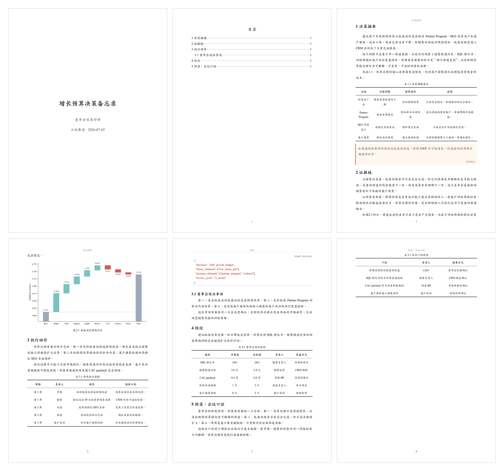
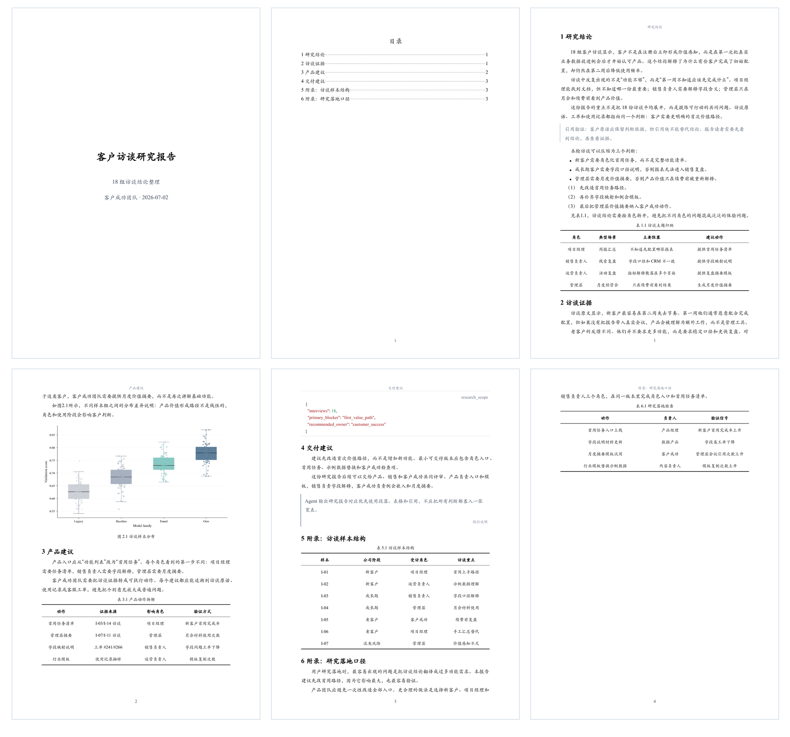
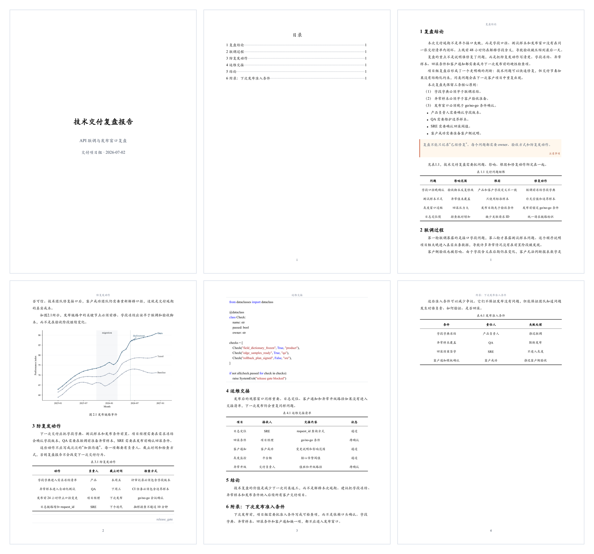
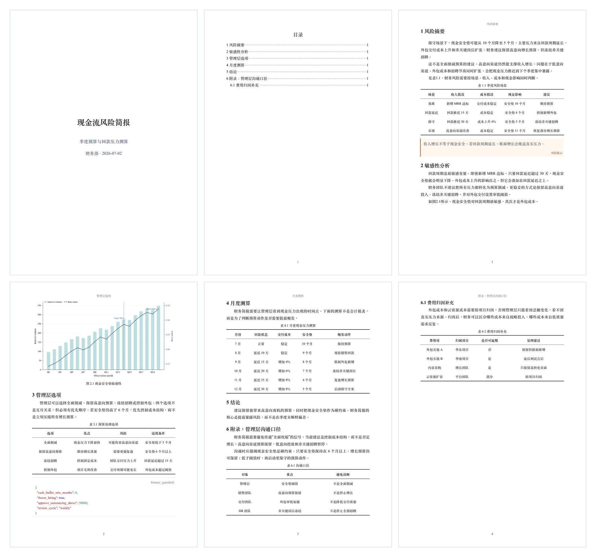
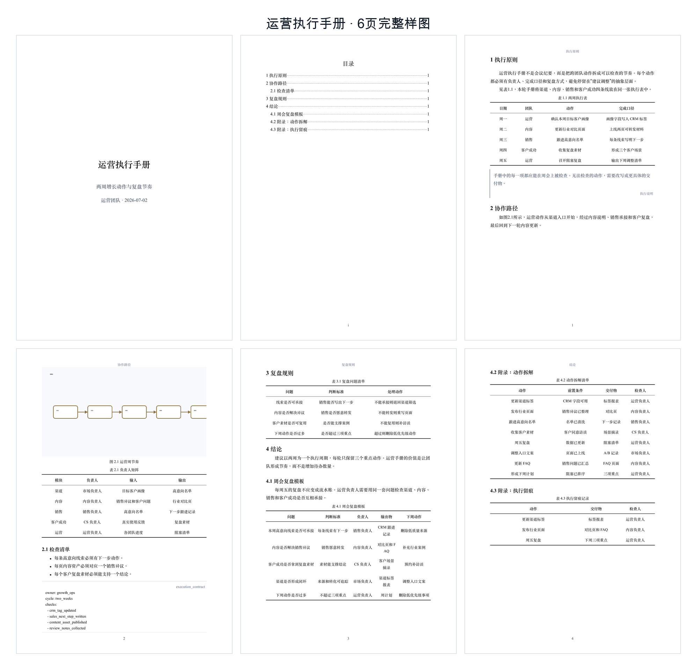
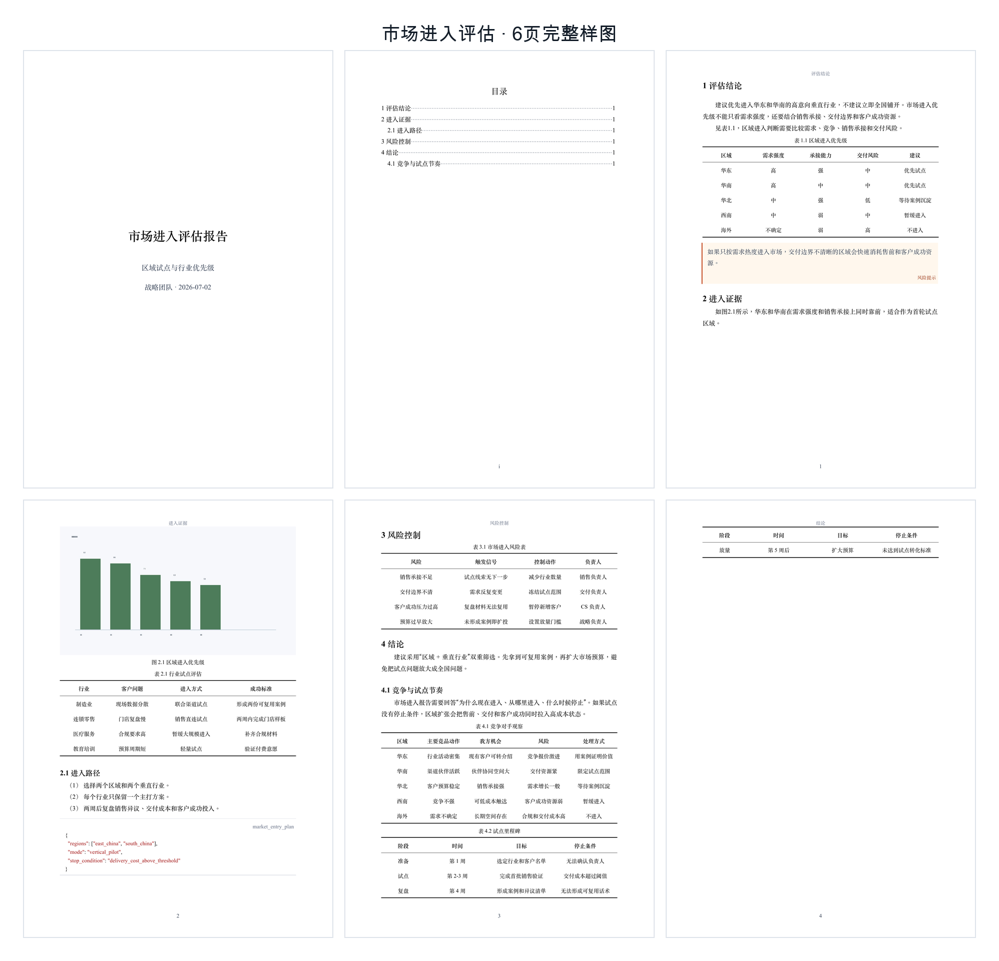

<h1 align="center">DocxKit</h1>

<p align="center">Editable Word documents for agents</p>

<p align="center">
  <a href="README.zh-CN.md">中文</a>
  ·
  <a href="#install">Install</a>
  ·
  <a href="#quick-start">Quick Start</a>
  ·
  <a href="#preview">Preview</a>
</p>

<p align="center">
  
  
</p>

---

Users provide materials or a writing goal. The agent prepares the content, and DocxKit exports a Word `.docx` they can keep editing. It supports both reports and ordinary documents transcribed from contracts, notices or letters, retaining their wording and clause numbers.

Users can provide any material the agent can read and understand, such as:

- Documents, spreadsheets, web pages, screenshots, or existing reports.
- Project materials, research notes, meeting notes, or data summaries.
- A clear report topic for the agent to research and organize.

## Preview

These screenshots show six complete 6-page Word reports generated for different business scenarios.

| | | |
|:---:|:---:|:---:|
| <sub><strong>Board budget decision</strong></sub> | <sub><strong>Customer interview research</strong></sub> | <sub><strong>Technical delivery review</strong></sub> |
|  |  |  |
| <sub><strong>Cash-flow risk brief</strong></sub> | <sub><strong>Operations playbook</strong></sub> | <sub><strong>Market entry assessment</strong></sub> |
|  |  |  |

## Install

### 1. Install the CLI

```bash
npm install -g @dztabel/docxkit
docx-kit --version
```

Output like this means the CLI is installed:

```text
docx-kit 0.1.63 (cli-contract 0.2)
```

### 2. Install one agent skill

#### 2.1 Codex

```bash
node -e "const fs=require('fs'),os=require('os'),path=require('path'),cp=require('child_process');const root=cp.execSync('npm root -g',{encoding:'utf8'}).trim();const src=path.join(root,'@dztabel','docxkit','skills','docxkit');const dest=path.join(os.homedir(),'.agents','skills','docxkit');fs.rmSync(dest,{recursive:true,force:true});fs.mkdirSync(path.dirname(dest),{recursive:true});fs.cpSync(src,dest,{recursive:true});console.log('Codex skill installed');"
```

Check the Codex skill in your terminal:

```bash
node -e "const fs=require('fs'),os=require('os'),path=require('path');const p=path.join(os.homedir(),'.agents','skills','docxkit','SKILL.md');if(!fs.existsSync(p))process.exit(1);console.log('Codex skill installed');"
```

This output means the skill is installed:

```text
Codex skill installed
```

Open Codex and type `$docxkit`. If you can select the skill with `Tab`, it is ready. If it does not appear, press `Cmd+K` / `Ctrl+K`, choose `Force Reload Skills`, or reopen Codex.

#### 2.2 Claude Code

```bash
node -e "const fs=require('fs'),os=require('os'),path=require('path'),cp=require('child_process');const root=cp.execSync('npm root -g',{encoding:'utf8'}).trim();const src=path.join(root,'@dztabel','docxkit','skills','docxkit');const dest=path.join(os.homedir(),'.claude','skills','docxkit');fs.rmSync(dest,{recursive:true,force:true});fs.mkdirSync(path.dirname(dest),{recursive:true});fs.cpSync(src,dest,{recursive:true});console.log('Claude Code skill installed');"
```

Check the Claude Code skill in your terminal:

```bash
node -e "const fs=require('fs'),os=require('os'),path=require('path');const p=path.join(os.homedir(),'.claude','skills','docxkit','SKILL.md');if(!fs.existsSync(p))process.exit(1);console.log('Claude Code skill installed');"
```

This output means the skill is installed:

```text
Claude Code skill installed
```

Open Claude Code and type `/docxkit`. If you can select the skill, it is ready. If it does not appear, run `/reload-skills` and try again. Older Claude Code versions may need a new window.

## Quick Start

### 1. Generate a Word report from provided material

```text
$docxkit Read my uploaded Excel, PDF, and meeting notes, then turn them into a formal project review report and export it as Word.
/docxkit Read my uploaded Excel, PDF, and meeting notes, then turn them into a formal project review report and export it as Word.
```

### 2. Research a topic and generate a Word report

```text
$docxkit Research recent developments in China's energy storage industry, organize the findings into an industry report, and export it as Word.
/docxkit Research recent developments in China's energy storage industry, organize the findings into an industry report, and export it as Word.
```

### 3. Turn a rough draft into a deliverable report

```text
$docxkit Rewrite this rough draft into a clear formal analysis report and export it as Word.
/docxkit Rewrite this rough draft into a clear formal analysis report and export it as Word.
```

### 4. Revise a generated report from feedback

```text
$docxkit Compress the report you just generated to 8 pages, rewrite chapter 2 for management readers, and export a new Word document.
/docxkit Compress the report you just generated to 8 pages, rewrite chapter 2 for management readers, and export a new Word document.
```

### 5. Transcribe an existing document into Word

```text
$docxkit Transcribe this contract into an ordinary Word document without a cover or TOC. Retain clause numbers, masks, punctuation and spaces, and compare it against the original.
/docxkit Transcribe this contract into an ordinary Word document without a cover or TOC. Retain clause numbers, masks, punctuation and spaces, and compare it against the original.
```

The agent reads the material, writes or transcribes it, exports Word, and performs the review required by the task.

## Keep Writing in the Result

The exported Word file is meant to be worked on, not just read:

- Captions, equation numbers, sources and the references to them use Word's own numbering. After adding or removing a table, figure or source, select all and press F9 (fn+F9 on a Mac); the numbers and every "see Table 1.3" or "[3]" update together.
- Layout lives in styles. Change the body, Heading 1, caption or three-line table style and the whole document follows.
- Enter after a heading gives body text; you can type straight after a table or code block; a table inserted in Word is a three-line table.
- Each ordered list numbers from 1 on its own and can be demoted and promoted.

A few operations need a small setting in Word or WPS first; the agent explains them on delivery (see the [Skill delivery instructions](skills/docxkit/SKILL.md#delivery-instructions--tell-the-user)). Edits made in Word do not flow back into the source used for rebuilding.

## Technical Details

The agent turns the material into DocxKit-ready intermediate content and runs:

```bash
docx-kit templates
docx-kit components
docx-kit build examples/report.md --out ./report --filename project-review.docx --strict
docx-kit qa ./report/project-review.docx --report-json ./report/report.json --out ./report/qa
```

DocxKit outputs:

```text
report/project-review.docx
report/report.json
report/build-result.json
report/qa/qa-result.json
```

Generated `.docx` files do not embed fonts by default. Each template declares its required font names and cross-platform fallback chain in the font table, so Word/WPS uses fonts installed on the recipient's computer while keeping the document editable. Pass `--embed-fonts` only to embed locally available fonts that may legally be embedded.

Three templates are built in: `executive-cn-docx` (KaiTi), `executive-cn-song-docx` (SimSun body, SimHei headings), and `executive-cn-official-docx` (Chinese official-document typography, FangSong body, no header or callouts). All support `document_mode: report` (cover and TOC) and `document_mode: document` (neither). KaiTi and SimSun default to report mode; the official-document template defaults to ordinary-document mode. `templates` lists supported combinations; `components` describes content components.

Ordinary-document mode (`document_mode: document`) turns an existing contract, notice or letter into Word as it is: no cover or table of contents, and a title is optional. `heading_numbering: none` keeps the original clause numbers; `punctuation_mode: preserve` keeps the original punctuation and spaces. Write a literal asterisk as `\*` (for example `138\*\*\*\*5678`), a pipe inside a table cell as `\|`, and a paragraph that starts with a number but is not a list item as `1\.`.

Captions and references are numbered automatically: by chapter in the KaiTi and SimSun templates (Table 1.1), continuously in the official-document template, in KaiTi and SimSun ordinary documents and in documents without heading numbers (Table 1). A table without a caption takes no number. New documents declare `numbering_rule: native-v1` at the top.

Punctuation is normalized by default: in Chinese text some half-width punctuation becomes full-width and extra spaces beside punctuation are removed. Use `punctuation_mode: preserve` to leave it untouched.

Supports native editable Word equations, references to tables, figures, equations and sources, and lists of figures and tables. In the build result, `checks` lists content problems (error-level ones such as dangling references fail the build) and `effective_document` states the document mode and numbering that took effect. `qa` checks the file structure; it does not compare the content with an original.

The [examples](examples/README.md) include a report, a memo, a contract, a notice and a letter, all buildable as they are.

LibreOffice and similar tools recalculate Word's numbering incorrectly. To preview or convert to PDF with them, make a render-only copy first:

```bash
docx-kit render-copy ./report/project-review.docx --out ./report/preview --filename preview.render-only.docx
```

The copy is for preview and conversion only and never changes the original; deliver the original Word file.

`docx-kit redline` compares two source files and produces a Word file with tracked changes: accepting all gives the new version, rejecting all gives the old one. See the [revision instructions](skills/docxkit/references/revising-documents.md).

Headings stay on the same page as the paragraph that follows them. When a tall figure is pushed to the next page and leaves the previous page half empty, `docx-kit build ... --settle-figures` (opt-in) measures the real pagination — with Microsoft Word on Windows, with LibreOffice elsewhere — and lets the figure fall back by a paragraph or two in the delivered document so the page fills; the source and `report.json` keep the author's order.

`report.json` is the editable source alongside the Markdown: it stores headings and captions as written, and rebuilding from it any number of times gives the same document.

## Troubleshooting

The public beta supports macOS Apple Silicon and Windows x64.

If global npm install skips optional dependencies, install the matching platform package explicitly:

```bash
npm install -g @dztabel/docxkit @dztabel/docxkit-darwin-arm64
```

When reporting a build failure, include:

- `docx-kit --version`
- `report/build-result.json`
- A minimal `content.md` that reproduces the issue

## Repository Scope

This public repository contains npm wrapper metadata, the command shim, public skills, documentation, and lightweight preview assets.

Renderer source, private templates, schemas, visual regression samples, and platform binaries are not included here. Platform binaries are distributed through npm platform packages.

## License

DocxKit is distributed through npm as a proprietary CLI binary. This repository provides the public wrapper, skills, and documentation for installing and using the CLI.
