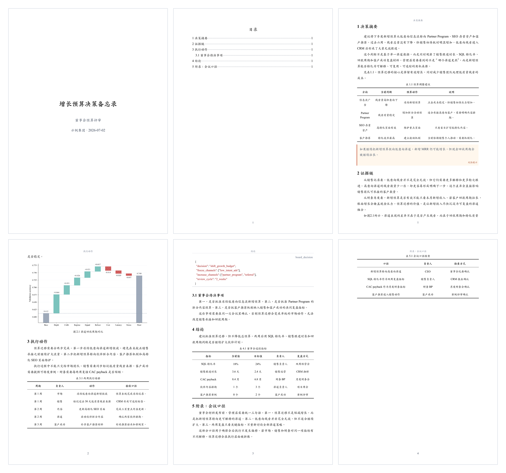
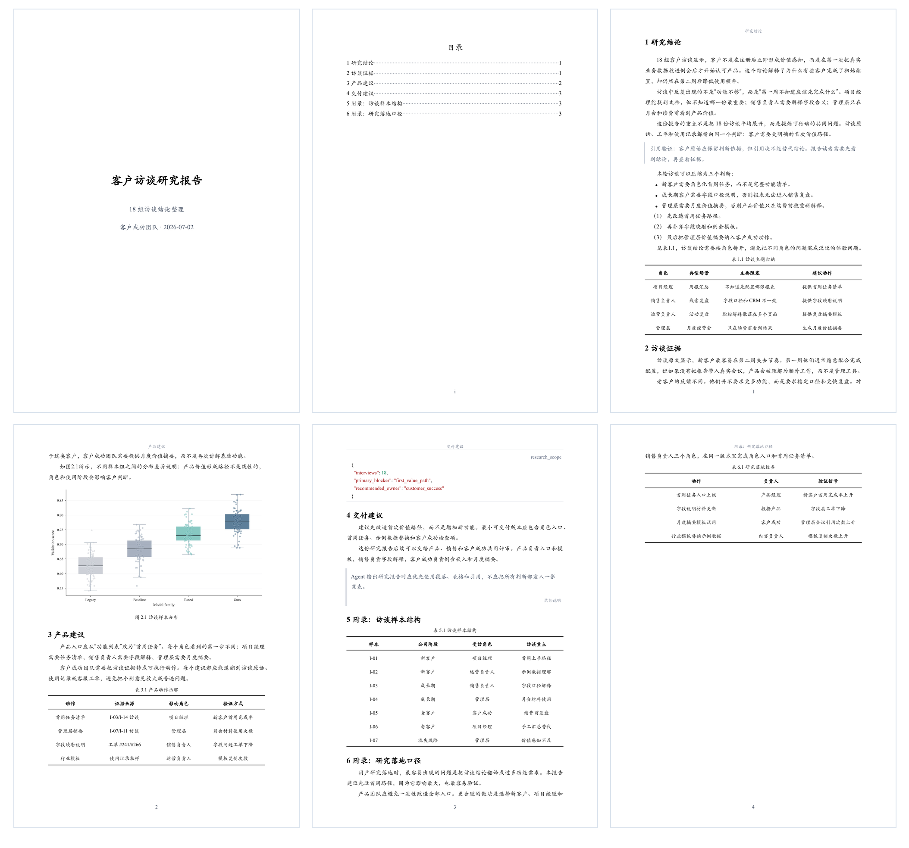
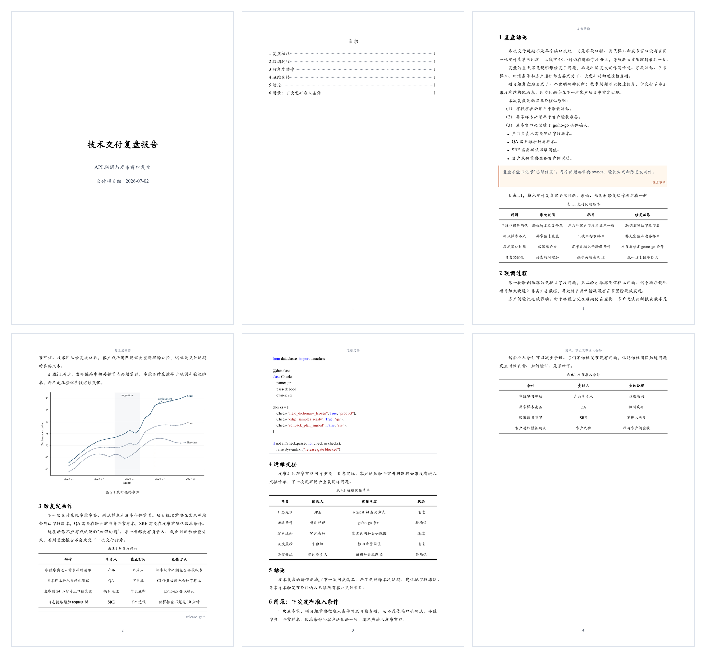
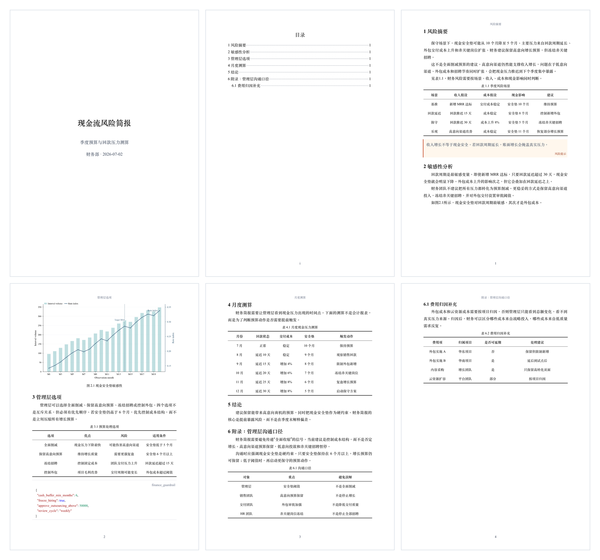
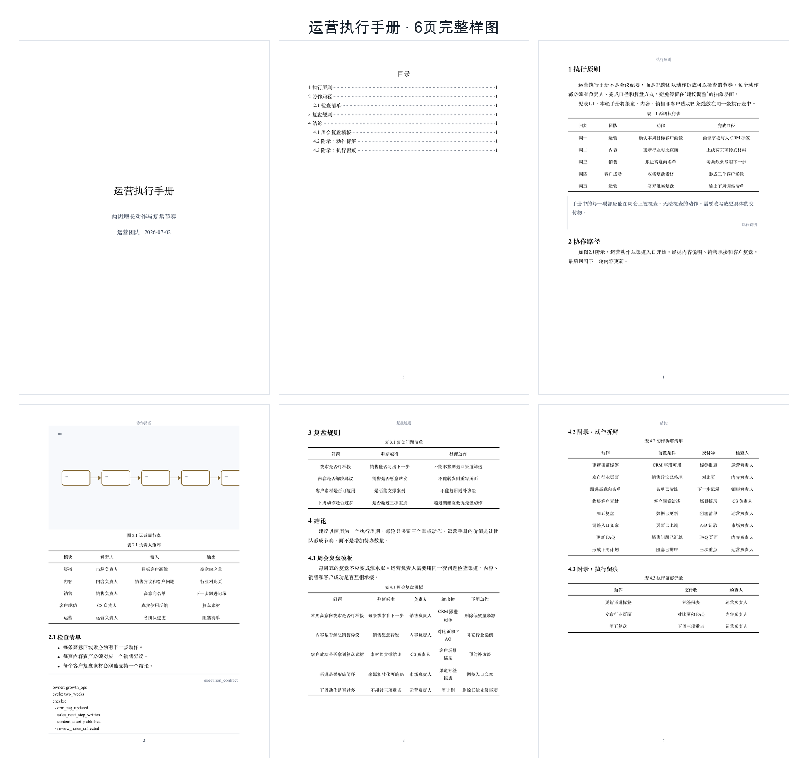
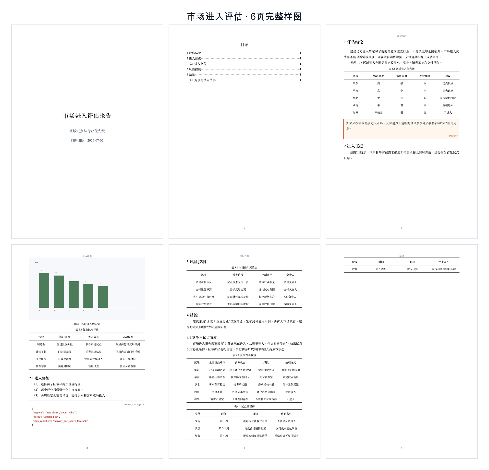

<h1 align="center">DocxKit</h1>

<p align="center">面向 Agent 的可续写 Word 文档导出工具</p>

<p align="center">
  <a href="README.md">English</a>
  ·
  <a href="#安装">安装</a>
  ·
  <a href="#快速开始">快速开始</a>
  ·
  <a href="#效果预览">效果预览</a>
</p>

<p align="center">
  
  
</p>

---

用户提供资料或写作目标，Agent 整理内容，DocxKit 导出可继续编辑的 Word `.docx`。既可以写报告，也可以把已有合同、通知、函件转成普通文档，保留原文和条款编号。

用户可以提供任意可被 Agent 读取和理解的资料，例如：

- 文档、表格、网页、截图或已有报告。
- 项目材料、调研资料、会议纪要或数据摘要。
- 一个明确的报告主题，由 Agent 自行检索和整理资料。

## 效果预览

以下截图展示 6 份不同业务场景的完整 6 页 Word 报告。

| | | |
|:---:|:---:|:---:|
| <sub><strong>董事会预算决策</strong></sub> | <sub><strong>客户访谈研究</strong></sub> | <sub><strong>技术交付复盘</strong></sub> |
|  |  |  |
| <sub><strong>现金流风险简报</strong></sub> | <sub><strong>运营执行手册</strong></sub> | <sub><strong>市场进入评估</strong></sub> |
|  |  |  |

## 安装

### 1. 安装 CLI

```bash
npm install -g @dztabel/docxkit
docx-kit --version
```

出现类似输出代表 CLI 安装成功：

```text
docx-kit 0.1.63 (cli-contract 0.2)
```

### 2. 安装 Agent skill（二选一）

#### 2.1 Codex

```bash
node -e "const fs=require('fs'),os=require('os'),path=require('path'),cp=require('child_process');const root=cp.execSync('npm root -g',{encoding:'utf8'}).trim();const src=path.join(root,'@dztabel','docxkit','skills','docxkit');const dest=path.join(os.homedir(),'.agents','skills','docxkit');fs.rmSync(dest,{recursive:true,force:true});fs.mkdirSync(path.dirname(dest),{recursive:true});fs.cpSync(src,dest,{recursive:true});console.log('Codex skill installed');"
```

检查 Codex skill 是否安装成功，在终端中输入：

```bash
node -e "const fs=require('fs'),os=require('os'),path=require('path');const p=path.join(os.homedir(),'.agents','skills','docxkit','SKILL.md');if(!fs.existsSync(p))process.exit(1);console.log('Codex skill installed');"
```

出现以下输出代表成功：

```text
Codex skill installed
```

打开 Codex 后输入 `$docxkit`。能按 `Tab` 选中该 skill，代表可用。若未出现，按 `Cmd+K` / `Ctrl+K` 选择 `Force Reload Skills`，或重新打开 Codex。

#### 2.2 Claude Code

```bash
node -e "const fs=require('fs'),os=require('os'),path=require('path'),cp=require('child_process');const root=cp.execSync('npm root -g',{encoding:'utf8'}).trim();const src=path.join(root,'@dztabel','docxkit','skills','docxkit');const dest=path.join(os.homedir(),'.claude','skills','docxkit');fs.rmSync(dest,{recursive:true,force:true});fs.mkdirSync(path.dirname(dest),{recursive:true});fs.cpSync(src,dest,{recursive:true});console.log('Claude Code skill installed');"
```

检查 Claude Code skill 是否安装成功，在终端中输入：

```bash
node -e "const fs=require('fs'),os=require('os'),path=require('path');const p=path.join(os.homedir(),'.claude','skills','docxkit','SKILL.md');if(!fs.existsSync(p))process.exit(1);console.log('Claude Code skill installed');"
```

出现以下输出代表成功：

```text
Claude Code skill installed
```

打开 Claude Code 后输入 `/docxkit`。能选中该 skill，代表可用。若未出现，输入 `/reload-skills` 后重试；旧版本 Claude Code 可重新打开窗口。

## 快速开始

### 1. 用户带资料生成 Word 报告

```text
$docxkit 请读取我上传的 Excel、PDF 和会议纪要，整理成一份正式项目复盘报告并导出 Word。
/docxkit 请读取我上传的 Excel、PDF 和会议纪要，整理成一份正式项目复盘报告并导出 Word。
```

### 2. 用户只给目标，Agent 自行调研

```text
$docxkit 请调研国内储能行业最新进展，整理成行业研究报告并导出 Word。
/docxkit 请调研国内储能行业最新进展，整理成行业研究报告并导出 Word。
```

### 3. 用户已有草稿，Agent 重写成可交付报告

```text
$docxkit 请把这份散乱的草稿改写成结构清晰的正式分析报告并导出 Word。
/docxkit 请把这份散乱的草稿改写成结构清晰的正式分析报告并导出 Word。
```

### 4. 用户基于反馈迭代报告

```text
$docxkit 请把刚才生成的报告压缩到 8 页，第二章改成更适合管理层阅读的版本，并重新导出 Word。
/docxkit 请把刚才生成的报告压缩到 8 页，第二章改成更适合管理层阅读的版本，并重新导出 Word。
```

### 5. 把已有文档转成 Word

```text
$docxkit 请把这份合同原样转成普通 Word 文档，不加封面和目录，保留条款编号、掩码、标点和空格，并逐项核对原件。
/docxkit 请把这份合同原样转成普通 Word 文档，不加封面和目录，保留条款编号、掩码、标点和空格，并逐项核对原件。
```

Agent 根据任务完成资料读取、写作或转录、Word 导出和必要的核对。

## 成品可以继续写

导出的 Word 可以直接接着写，不是一份只能看的定稿：

- 题注、公式编号、资料来源和正文里的引用都用 Word 自己的编号。增删表、图或来源后全选按 F9（Mac 上是 fn+F9），编号和“见表 1.3”“[3]”一起更新。
- 版式都在样式里。改“正文”“标题 1”“题注”“三线表”，全篇跟着变。
- 标题后回车就是正文；表格、代码块后面可以直接输入；在 Word 里新插的表格自动是三线表。
- 每个有序列表各自从 1 编号，可以升降级。

少数操作要先在 Word 或 WPS 里做一点设置，Agent 交付时会一并说明（见 [Skill 的交付说明](skills/docxkit/SKILL.md#delivery-instructions--tell-the-user)）。在 Word 里改过的内容不会回到生成用的源文件。

## 技术细节

Agent 会自动把资料整理成 DocxKit 可处理的中间内容，并调用：

```bash
docx-kit templates
docx-kit components
docx-kit build examples/report.md --out ./report --filename 项目复盘报告.docx --strict
docx-kit qa ./report/项目复盘报告.docx --report-json ./report/report.json --out ./report/qa
```

DocxKit 输出：

```text
report/项目复盘报告.docx
report/report.json
report/build-result.json
report/qa/qa-result.json
```

生成的 `.docx` 默认不内嵌字体：每个模版都在 fontTable 中声明规范字体名与跨平台替代链，Word/WPS 会优先使用目标电脑已安装的字体并保持文档可编辑。若收件人环境缺少规范字体，用 `--embed-fonts` 显式嵌入本机可合法嵌入的字体子集。

内置三个模板：`executive-cn-docx`（楷体）、`executive-cn-song-docx`（宋体正文、黑体标题）和 `executive-cn-official-docx`（公文模板，仿宋正文、无页眉、不支持提示框）。三个模板都支持 `document_mode: report`（有封面、目录）和 `document_mode: document`（无封面、目录）；楷体、宋体默认报告模式，公文默认普通文档。`templates` 返回各模板实际支持的组合，`components` 返回内容组件的用法。

普通文档（`document_mode: document`）用来把已有的合同、通知、函件原样做成 Word：没有封面和目录，可以没有标题；`heading_numbering: none` 保留原文的条款编号；`punctuation_mode: preserve` 保留原文的标点和空格。原文里的星号写成 `\*`（如 `138\*\*\*\*5678`），表格单元格里的竖线写成 `\|`，以数字开头但不是列表的段落写成 `1\.`。

题注和引用自动编号：楷体、宋体模板按章编号（表 1.1），公文模板和不编号的文档全文连续编号（表 1）；没有题注的表不占表号。新写的文档在开头声明 `numbering_rule: native-v1`。

默认会规范化标点：中文语境里的部分半角标点换成全角，并去掉标点旁多余的空格。不希望改动时用 `punctuation_mode: preserve`。

支持 Word 原生可编辑的公式，表、图、公式、来源四类引用，以及图目录、表目录。构建结果里的 `checks` 列出内容问题（悬空引用等 error 级问题会使构建失败），`effective_document` 说明实际生效的文档模式和编号方式。`qa` 检查的是文件结构，不核对内容是否与原件一致。

[示例](examples/README.md)包含报告、备忘、合同、通知、函件各一份，可以直接构建。

LibreOffice 等工具会把 Word 的编号算错。需要用它们预览或转 PDF 时，先生成一份渲染副本：

```bash
docx-kit render-copy ./report/项目复盘报告.docx --out ./report/preview --filename preview.render-only.docx
```

副本只用于预览和转换，不改原件；交付的仍是原来的 Word 文件。

修订稿用 `docx-kit redline` 比较两份源文件，生成带修订标记的 Word：接受全部修订得到新稿，拒绝全部得到旧稿。用法见[修订说明](skills/docxkit/references/revising-documents.md)。

标题与它后面的段落保持在同一页。一张高图被整张推到下一页、前一页空出半页时，可以加 `docx-kit build ... --settle-figures`（可选）：它实测分页（Windows 上用本机 Microsoft Word，其它平台用 LibreOffice），在成品里让这张图往后让一两段，把页面填上；输入与 `report.json` 仍是作者的次序。

`report.json` 与 Markdown 一样是可编辑的源：标题、题注按原文保存，拿它重建多少次，得到的都是同一份文档。

## 排障

当前公开测试版支持 macOS Apple Silicon 与 Windows x64。

如果全局 npm 安装跳过了 optional dependencies，显式安装对应平台包：

```bash
npm install -g @dztabel/docxkit @dztabel/docxkit-darwin-arm64
```

构建失败时，提交 issue 请附：

- `docx-kit --version`
- `report/build-result.json`
- 可复现问题的最小 `content.md`

## 仓库范围

本公开仓库包含 npm wrapper 元数据、命令 shim、公开 skills、文档和轻量预览资产。

渲染器源码、私有模板、schemas、视觉回归样例和平台二进制不包含在本仓库中。平台二进制通过 npm 平台包分发。

## 许可

DocxKit 以专有 CLI 二进制形式通过 npm 分发。本仓库提供用于安装和使用 CLI 的公开 wrapper、skills 和文档。
